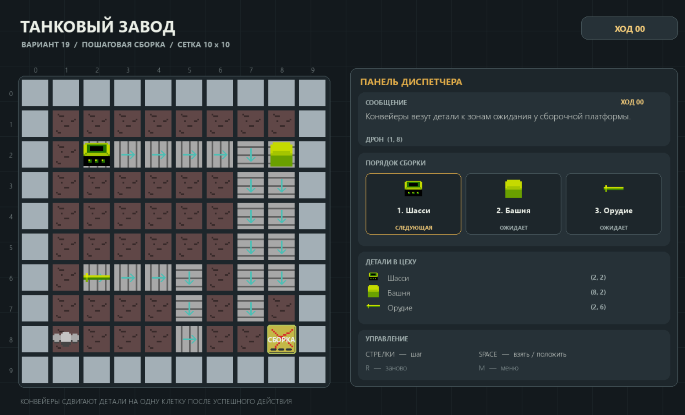
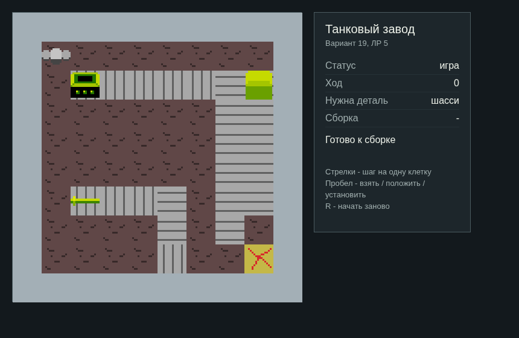
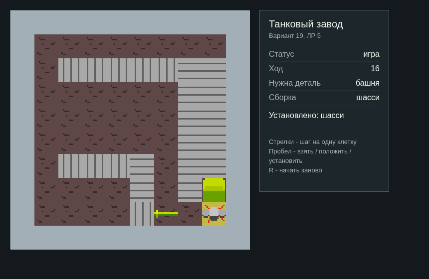
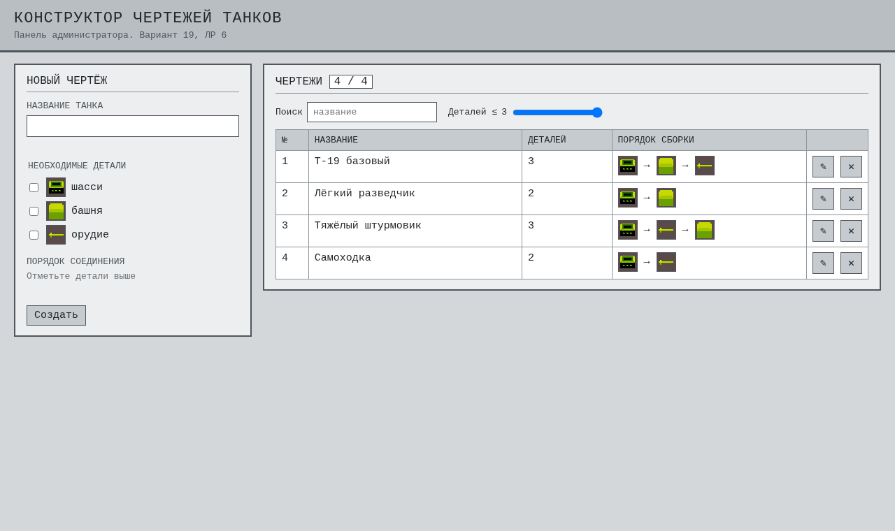
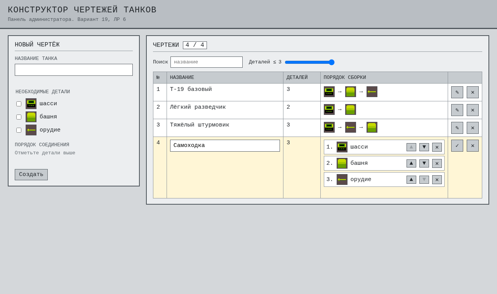
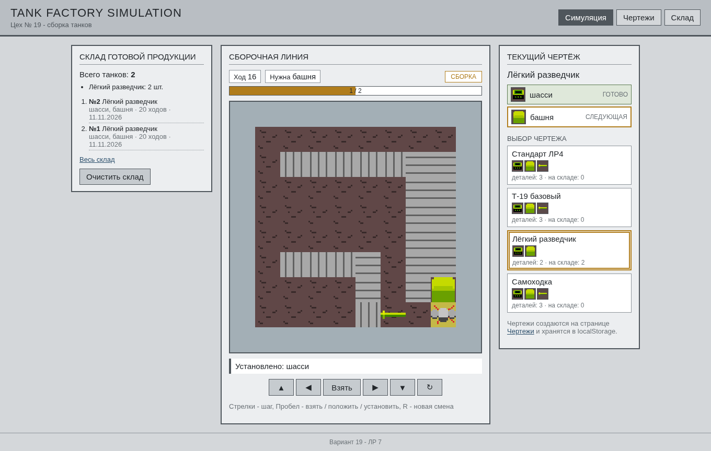
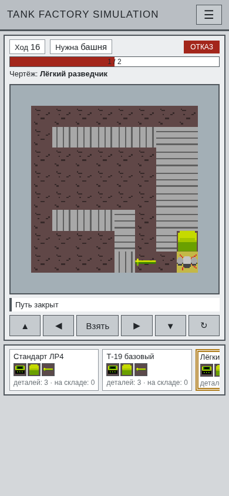

# Танковый завод - вариант 19

Пошаговая головоломка на Pygame: дрон ходит по сетке 10 x 10, подбирает шасси, башню и орудие и ставит их на сборочную платформу в порядке шасси - башня - орудие. Конвейеры после каждого успешного хода сдвигают свободные детали на одну клетку.



## Запуск

Нужен Python 3.12+.

```powershell
python -m pip install -r requirements.txt
python main.py
```

Тесты:

```powershell
python -m unittest discover -s tests -v
```

## Управление

- Стрелки - шаг дрона на одну клетку
- Пробел - взять деталь / положить / установить на платформу
- F5 - сохранить сессию в `factory_save.json`
- F9 - загрузить сохранение
- R - начать заново
- M - меню
- Esc - выход

После победы игра просит имя и дописывает результат в `scores.csv`.

## Файлы данных (ЛР2)

Уровень читается из `factory_layout.txt` при старте. Если файла нет или он битый, берётся встроенная схема, ошибка пишется в сообщение и в лог.

Символы сетки:

| Символ | Значение |
|--------|----------|
| `#` | стена |
| `.` | пол |
| `D` | старт дрона |
| `S` | сборка |
| `C` или `>` | конвейер вправо |
| `<` | конвейер влево |
| `^` | конвейер вверх |
| `v` | конвейер вниз |
| `H` | шасси |
| `B` | башня |
| `N` | орудие |

Строки `PART H x y` кладут деталь поверх клетки (нужно, когда деталь стоит на конвейере). Комментарии в файле начинаются с `# ` (решётка и пробел).

Пример куска конфига:

```text
##########
#.>>>>>vv#
#......vv#
#D...>..S#
##########
PART H 2 2
PART B 8 2
PART N 2 6
```

Другие файлы:

- `factory_save.json` - сохранение по F5 (ход, дрон, детали, стек сборки)
- `scores.csv` - таблица рекордов (заголовок создаётся при первой записи)
- `game_flight.log` - лог шагов, сборок и победы

## Структура

```text
PyGame_TankFactory/
├── main.py
├── factory_layout.txt
├── requirements.txt
├── assets/
├── tank_factory/
│   ├── constants.py
│   ├── entities.py
│   ├── factory.py
│   ├── layout.py          # разбор factory_layout.txt
│   ├── persistence.py     # JSON, CSV, logging
│   └── renderer.py
├── tests/
├── tests_bot/
├── py_bot/                 # ЛР3 Telegram-бот
├── tank_factory_js/        # ЛР4 ядро на JavaScript
├── tank_factory_widget/    # ЛР5 виджет на CSS Grid
├── tank_blueprints/        # ЛР6 конструктор чертежей (CRUD)
├── tank_factory_site/      # ЛР7 сайт Tank Factory Simulation
├── sessions/
└── screenshots/
```

## Лабораторные

- **ЛР1** - сетка, дрон, конвейеры, сборка [0, 1, 2]
- **ЛР2** - конфиг уровня, сохранение F5, лог, CSV рекордов
- **ЛР3** - Telegram-бот «Диспетчер Цеха»: см. `py_bot/README.md`
- **ЛР4** - ядро на JavaScript: см. `tank_factory_js/README.md`
- **ЛР5** - веб-виджет на CSS Grid: см. `tank_factory_widget/README.md`
- **ЛР6** - конструктор чертежей танков (CRUD + localStorage): см. `tank_blueprints/README.md`
- **ЛР7** - сайт «Tank Factory Simulation»: см. `tank_factory_site/README.md`

## ЛР4. Ядро на JavaScript

Та же логика сетки, что в Python, без отрисовки. Классы: `FactoryGrid`, `Drone`, `Conveyor`, `PartStack`. Уровень читается из `factory_layout.txt`.

```powershell
cd tank_factory_js
node selftest.js
```

В `package.json` указано `"type": "module"`. Самопроверка пишет результат через `console.log`.

После каждого успешного хода дрона (`moveDrone` или `interact`) увеличивается `turnCount`, и конвейеры одновременно сдвигают свободные детали на одну клетку.

Сборка проверяется через методы массива: `PartStack.push(kind)` принимает только следующую деталь, готовность - `items.join(",") === "chassis,turret,cannon"`.

## ЛР5. Веб-виджет

Сетка 10x10 собрана на CSS Grid. Ядро подключается из `tank_factory_js`. Клетки получают классы `.wall`, `.floor`, `.assembly`, `.conveyor-left`, `.conveyor-right`, `.conveyor-up`, `.conveyor-down`. Дрон и детали - отдельные элементы с классами `.drone`, `.chassis`, `.turret`, `.cannon`. Фоном у этих классов стоят спрайты из `assets/` (те же, что в ЛР 1-3). При ходе позиция меняется через `transform`, движение плавное за счёт `transition`.

ES-модули не открываются через `file://`. Сервер поднимается из корня проекта:

```powershell
python -m http.server 8000
```

Дальше в браузере: `http://localhost:8000/tank_factory_widget/`

Управление: стрелки - шаг на одну клетку, Пробел - взять / положить / установить, R - заново.

Отрисовка сетки вынесена в `tank_factory_widget/js/board.js`, а клавиатура и связь с ядром - в класс `Widget` (`tank_factory_widget/js/Widget.js`). Этот класс подключается на сайте ЛР7.





## ЛР6. Конструктор чертежей танков

Панель администратора для технологических карт сборки. Чертёж - `id` (`crypto.randomUUID()`), название танка, список нужных деталей без повторов и строгий порядок их соединения. Создание формой, таблица с фильтром «Деталей ≤ N» и поиском, редактирование прямо в строке таблицы, удаление с подтверждением. Всё хранится в `localStorage` под ключом `tankFactory.blueprints` и остаётся после перезагрузки.

```powershell
python -m http.server 8000
```

Открыть `http://localhost:8000/tank_blueprints/`

Самопроверка хранилища:

```powershell
cd tank_blueprints
node selftest.js
```

Проверки при сохранении: пустое или длинное название, повтор названия, нет деталей, повтор детали, неизвестная деталь. Ошибки пишутся под полями. Тексты в таблицу выводятся через `escapeHtml`.





## ЛР7. Сайт Tank Factory Simulation

Три страницы с общей шапкой и меню: «Симуляция», «Чертежи», «Склад». Каркас - CSS Grid, колонки и меню - Flexbox. На главной в центре виджет из ЛР5, справа текущий чертёж и хотбар карточек из `localStorage` (их заполняет конструктор ЛР6), слева склад готовой продукции. Клик по карточке задаёт порядок сборки для `PartStack`. Без выбора работает порядок из ЛР4 (шасси - башня - орудие). Над полем HUD: полоса сборки меняет ширину и цвет по состоянию (`low`, `mid`, `high`, `done`, `alert`). Собранный танк попадает на склад (`tankFactory.warehouse`).

Оформление светло-серое со строгими рамками. На телефоне меню прячется в бургер, страница не прокручивается, поле подгоняется под экран, хотбар становится лентой, под полем кнопки управления.

Открыть `http://localhost:8000/tank_factory_site/`

```powershell
cd tank_factory_site
node selftest.js
```




