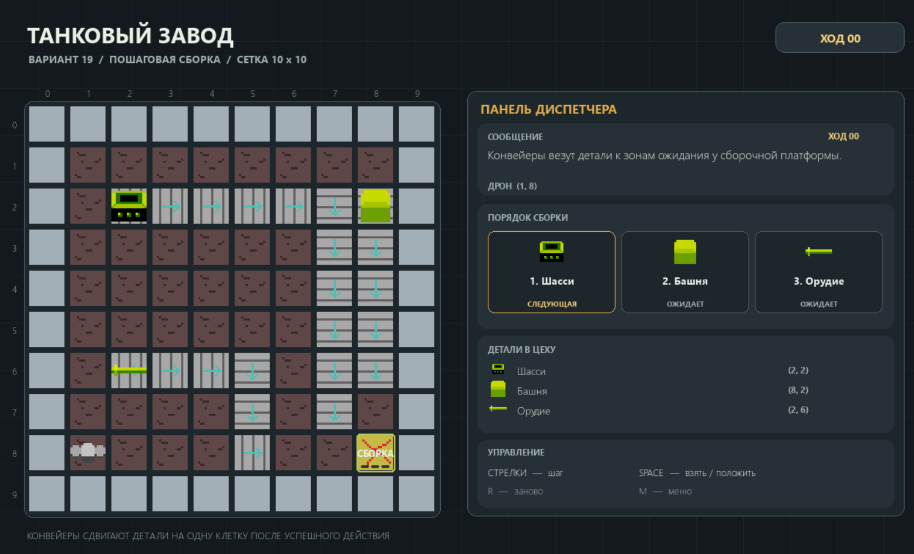

# Танковый завод - вариант 19

Пошаговая головоломка на Pygame: дрон ходит по сетке 10 x 10, подбирает шасси, башню и орудие и ставит их на сборочную платформу в порядке шасси - башня - орудие. Конвейеры после каждого успешного хода сдвигают свободные детали на одну клетку.



## Запуск

Нужен Python 3.12+.

```powershell
python -m pip install -r requirements.txt
python main.py
```

Тесты:

```powershell
python -m unittest discover -s tests -v
```

## Управление

- Стрелки - шаг дрона на одну клетку
- Пробел - взять деталь / положить / установить на платформу
- F5 - сохранить сессию в `factory_save.json`
- F9 - загрузить сохранение
- R - начать заново
- M - меню
- Esc - выход

После победы игра просит имя и дописывает результат в `scores.csv`.

## Файлы данных (ЛР2)

Уровень читается из `factory_layout.txt` при старте. Если файла нет или он битый, берётся встроенная схема, ошибка пишется в сообщение и в лог.

Символы сетки:

| Символ | Значение |
|--------|----------|
| `#` | стена |
| `.` | пол |
| `D` | старт дрона |
| `S` | сборка |
| `C` или `>` | конвейер вправо |
| `<` | конвейер влево |
| `^` | конвейер вверх |
| `v` | конвейер вниз |
| `H` | шасси |
| `B` | башня |
| `N` | орудие |

Строки `PART H x y` кладут деталь поверх клетки (нужно, когда деталь стоит на конвейере). Комментарии в файле начинаются с `# ` (решётка и пробел).

Пример куска конфига:

```text
##########
#.>>>>>vv#
#......vv#
#D...>..S#
##########
PART H 2 2
PART B 8 2
PART N 2 6
```

Другие файлы:

- `factory_save.json` - сохранение по F5 (ход, дрон, детали, стек сборки)
- `scores.csv` - таблица рекордов (заголовок создаётся при первой записи)
- `game_flight.log` - лог шагов, сборок и победы

## Структура

```text
PyGame_TankFactory/
├── main.py
├── factory_layout.txt
├── requirements.txt
├── assets/
├── tank_factory/
│   ├── constants.py
│   ├── entities.py
│   ├── factory.py
│   ├── layout.py          # разбор factory_layout.txt
│   ├── persistence.py     # JSON, CSV, logging
│   └── renderer.py
├── tests/
└── screenshots/
```

## Лабораторные

- **ЛР1** - сетка, дрон, конвейеры, сборка [0, 1, 2]
- **ЛР2** - конфиг уровня, сохранение F5, лог, CSV рекордов
- **ЛР3** - Telegram-бот «Диспетчер Цеха»: см. `py_bot/README.md`
- **ЛР4** - ядро на JavaScript: см. `tank_factory_js/README.md`
