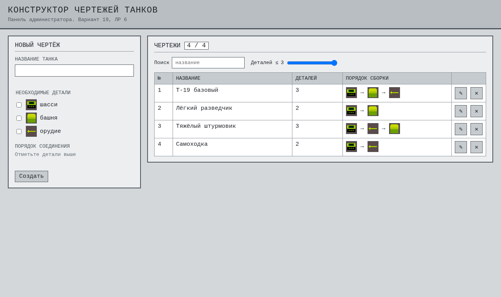
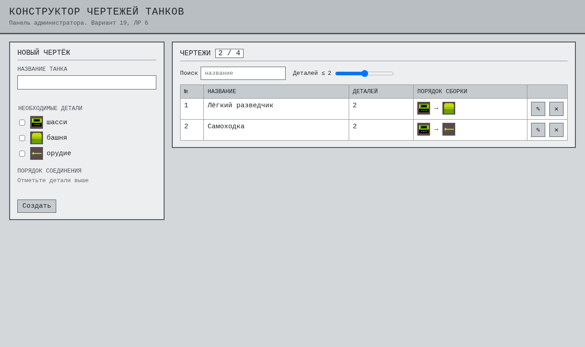
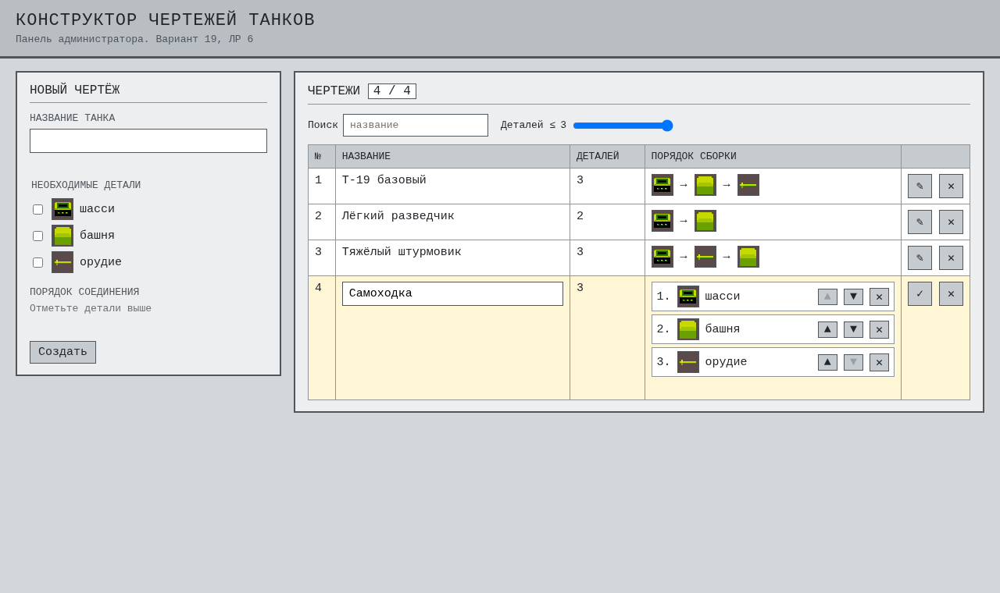
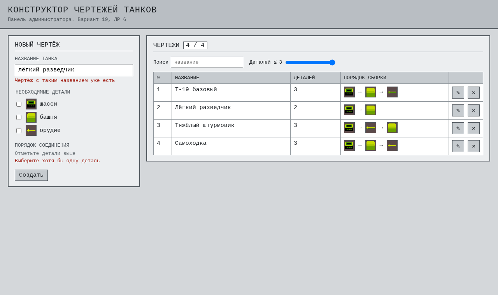
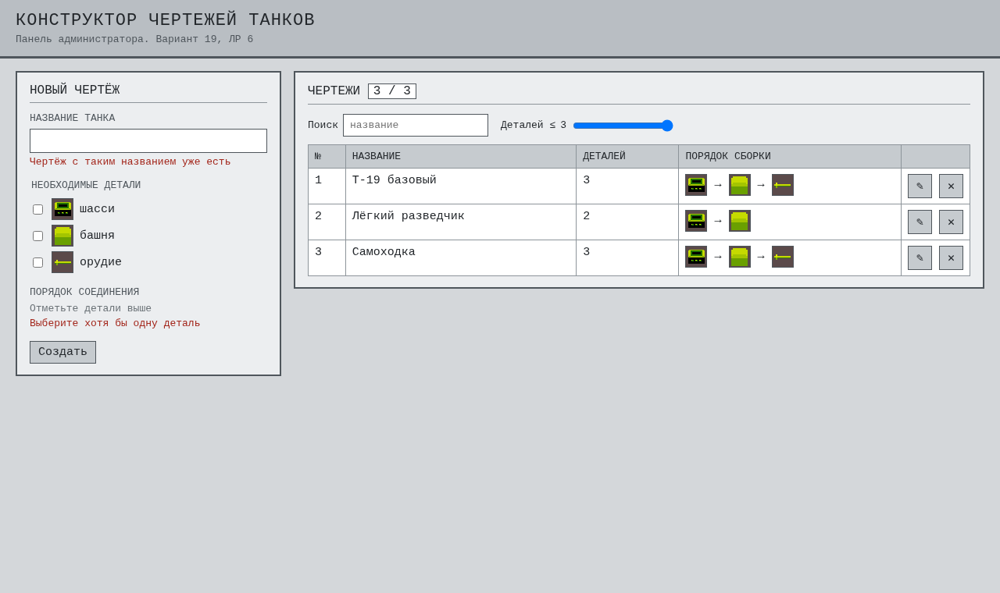
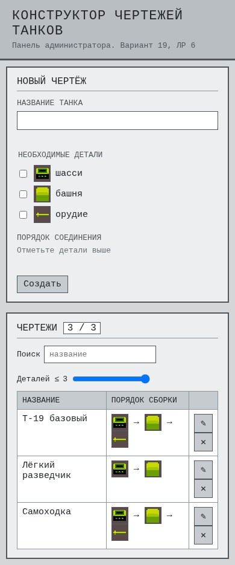

# ЛР6. Конструктор чертежей танков

Панель администратора: CRUD для чертежей сборки (технологических карт). Данные лежат в `localStorage` и не пропадают после перезагрузки.

## Запуск

ES-модули не работают через `file://`, поэтому нужен сервер из корня проекта:

```powershell
python -m http.server 8000
```

Открыть `http://localhost:8000/tank_blueprints/`

Самопроверка:

```powershell
cd tank_blueprints
node selftest.js
```

## Сущность «Чертёж»

| Поле | Тип | Что значит |
|------|-----|------------|
| `id` | строка | `crypto.randomUUID()`, задаётся при создании, не меняется |
| `name` | строка | название танка, от 1 до 40 символов, без повторов (регистр не важен) |
| `parts` | массив строк | детали `chassis`, `turret`, `cannon` без повторов, порядок в массиве = строгий порядок соединения |

Ключ `tankFactory.blueprints`, значение - JSON-массив:

```json
[{ "id": "3f2a9c1e-...", "name": "Т-19 базовый", "parts": ["chassis", "turret", "cannon"] }]
```

При первом запуске создаётся и сразу сохраняется чертёж «Т-19 базовый» с порядком из ЛР4. Если в ключе лежит битый JSON, список считается пустым, страница не падает.

## Что умеет

| Действие | Как |
|----------|-----|
| Create | форма слева: название, отметить детали, расставить порядок ▲ ▼, «Создать» |
| Read | таблица справа: номер, название, число деталей, порядок картинками |
| Фильтр | ползунок «Деталей ≤ N» (числовое поле) и поиск по названию |
| Update | ✎ в строке - строка становится редактируемой прямо в таблице: название, ▲ ▼, ✕ убрать деталь, «+ деталь» добавить. ✓ сохранить, ✕ отмена |
| Delete | ✕ в строке, подтверждение `confirm` |

Ошибки пишутся красным под полем (`span.error`), а не через `alert`. В форме создания и в строке редактирования проверки одинаковые - обе вызывают `BlueprintStore.validate`:

- название не пустое, не длиннее 40 символов, не совпадает с другим чертежом
- выбрана хотя бы одна деталь
- детали только из списка и не повторяются (`new Set(parts).size === parts.length`)

У поля названия есть ещё `required` и `maxlength="40"`, но форма стоит с `novalidate`, чтобы все ошибки показывались одинаково через JS.

## Как устроен код

- `js/BlueprintStore.js` - данные без DOM: `load`, `save`, `list`, `get`, `create`, `update`, `remove`, `validate`, а ещё `moveItem`, `filterBlueprints`, `escapeHtml`, `generateId`. Хранилище передаётся в конструктор: в браузере `localStorage`, в тесте простой объект.
- `js/crud.js` - интерфейс. Таблица рисуется шаблонной строкой в `tbody.innerHTML`, все тексты пользователя проходят через `escapeHtml`. На кнопки строк один обработчик `click` на `tbody` (делегирование), кнопка определяется по классу `btn-edit`, `btn-delete`, `btn-save`, `btn-cancel`.
- После каждой операции вызывается `save()` всего массива.
- Если чертежи поменяли в другой вкладке (например, на сайте ЛР7), таблица перерисовывается по событию `storage`.

## Как тестировать

1. Добавить чертёж «Лёгкий разведчик» из шасси и башни - строка появилась.
2. Ещё раз «лёгкий разведчик» без деталей - две ошибки под полями, ничего не сохранилось.
3. Ползунок на 2 - остаются только чертежи с одной-двумя деталями. Поиск «разв» - только разведчик.
4. ✎ у чертежа, поменять порядок или название, ✓ - в таблице новые данные. Стереть название и нажать ✓ - ошибка прямо в строке.
5. ✕ у чертежа, подтвердить - строка пропала.
6. F5 - всё на месте.
7. F12 → Application → Local Storage → `tankFactory.blueprints`: там тот же JSON.

## Структура

```text
tank_blueprints/
├── index.html
├── package.json
├── selftest.js
├── css/style.css        - шапка и цвета (переменные)
├── css/crud.css         - форма, таблица, иконки (его же берёт сайт ЛР7)
├── js/BlueprintStore.js
├── js/crud.js
└── screenshots/
```

Последний запуск `selftest.js`: 33 OK, 0 FAIL.

## Скриншоты












