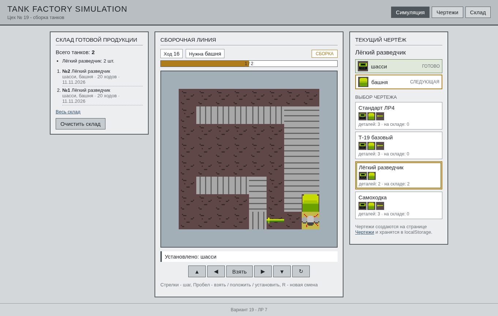
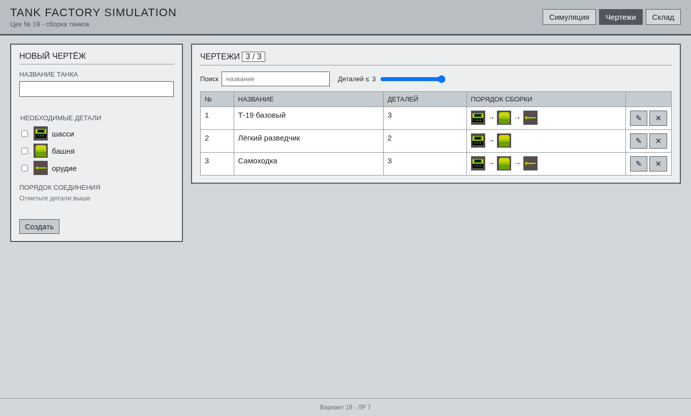
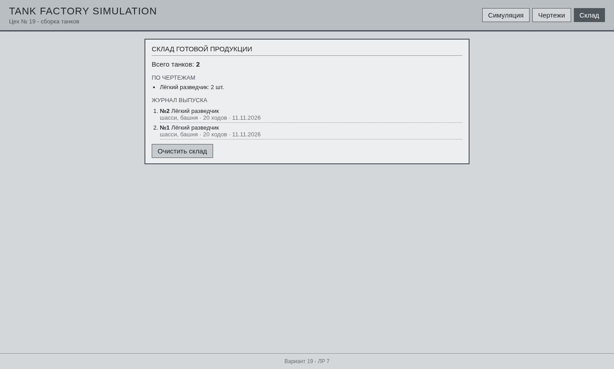
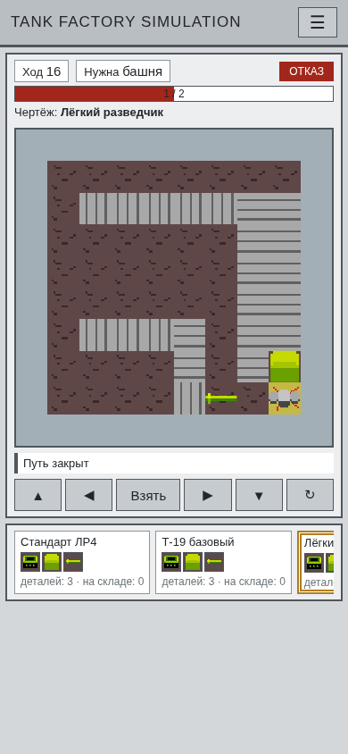
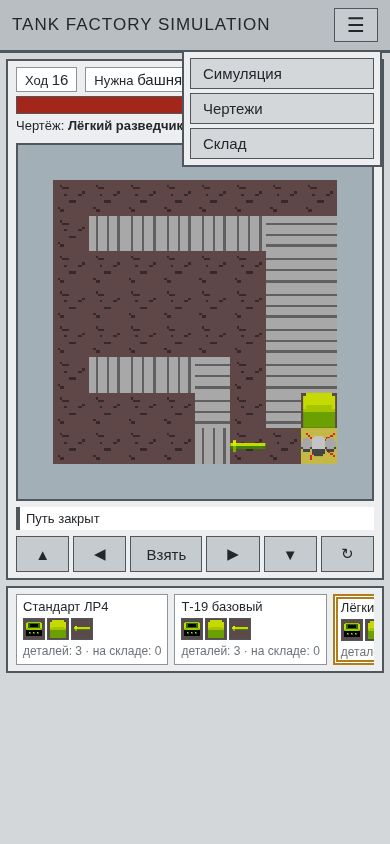

# ЛР7. Сайт Tank Factory Simulation

Многостраничный сайт вокруг виджета. Главная: в центре пошаговый виджет (ядро ЛР4 и класс `Widget` из ЛР5), справа текущий чертёж и хотбар чертежей из конструктора ЛР6, слева склад готовой продукции. Ещё две страницы: «Чертежи» (CRUD из ЛР6 внутри сайта) и «Склад» (весь журнал выпуска).

По варианту 19 виджет остаётся на CSS Grid (как в ЛР5), а не на canvas, и оформление светло-серое «индустриальное» со строгими рамками, а не тёмная тема из примера методички.

## Запуск

ES-модули не грузятся через `file://` (браузер блокирует `import` без http), поэтому сервер из корня проекта:

```powershell
python -m http.server 8000
```

Открыть `http://localhost:8000/tank_factory_site/`

Самопроверка:

```powershell
cd tank_factory_site
node selftest.js
```

## Страницы

| Страница | Файл | Что там |
|----------|------|---------|
| Симуляция | `index.html` | виджет, HUD, текущий чертёж, хотбар, последние танки со склада |
| Чертежи | `pages/blueprints.html` | создание, фильтр, редактирование, удаление чертежей (`crud.js` из ЛР6) |
| Склад | `pages/warehouse.html` | сколько танков, по чертежам, журнал выпуска, очистка |

Шапка, меню и подвал одинаковые на всех страницах, стили общие в `css/style.css` с переменными цветов в `:root`.

## Управление

| Клавиши | Действие |
|---------|----------|
| Стрелки | шаг дрона |
| Пробел | взять / положить / установить |
| R | новая смена |

Под полем те же действия кнопками: ▲ ◀ Взять ▶ ▼ и ↻ (новая смена). На телефоне это основное управление.

## Хотбар и связь с ЛР6

Хотбар - карточки чертежей из `localStorage` (`tankFactory.blueprints`): название, детали картинками, число деталей и сколько таких танков уже на складе. Первая карточка «Стандарт ЛР4» - порядок шасси - башня - орудие.

Клик по карточке выделяет её рамкой, `id` записывается в `tankFactory.currentBlueprint`, и смена начинается заново с `new PartStack(order)` - сборка идёт в порядке этого чертежа. После перезагрузки выбранный чертёж и список на месте, потому что читаются из `localStorage`. Если чертёж поменяли во второй вкладке, хотбар обновляется по событию `storage` без перезагрузки.

## HUD

Над полем: ход, нужная деталь, статус и полоса сборки. Значение берётся из ядра: `factory.stack.items.length / factory.stack.order.length`. После каждого действия `hud.js` меняет `style.width` у `#meter-fill`, `textContent` у подписей и класс состояния:

| Класс | Когда | Цвет |
|-------|-------|------|
| `low` | ничего не установлено | серый |
| `mid` | меньше 60% | жёлтый |
| `high` | 60% и больше | оливковый |
| `done` | танк собран | зелёный |
| `alert` | ход не удался (стена, не та деталь) | красный |

## Склад

Когда `FactoryGrid` переходит в статус `won`, танк записывается в `tankFactory.warehouse`: номер, название чертежа, детали, число ходов, дата. На главной видны последние 6, на странице «Склад» - все.

## Вёрстка

- каркас страницы - CSS Grid: `grid-template-areas: "header" "main" "footer"`
- колонки главной, шапка, кнопки, хотбар - Flexbox, виджет по центру
- до 1080px: поле сверху, склад и чертёж под ним
- до 768px (телефон): меню прячется в бургер ☰ (класс `.mobile-menu.open`), страница не прокручивается (`overflow: hidden`, высота `100dvh`), поле подгоняется под высоту экрана, склад, подсказки и подвал скрыты, хотбар становится горизонтальной лентой
- поле квадратное (`aspect-ratio: 1`), фишки двигаются в процентах, поэтому сетка сжимается вместе с экраном

## Структура

```text
tank_factory_site/
├── index.html
├── pages/blueprints.html
├── pages/warehouse.html
├── package.json
├── selftest.js
├── css/style.css
├── js/site.js                - бургер-меню и запуск нужной страницы
├── js/widget-integration.js  - Widget из ЛР5, выбор чертежа, запись на склад
├── js/hotbar.js              - карточки хотбара и шаги текущего чертежа
├── js/hud.js                 - полоса сборки и статус
├── js/blueprint.js           - текущий чертёж и его порядок
├── js/Warehouse.js           - данные склада
├── js/warehouse-view.js      - вывод склада
└── screenshots/
```

Используются также `tank_factory_js/` (ЛР4), `tank_factory_widget/js/` (ЛР5), `tank_blueprints/` (ЛР6), `factory_layout.txt` и `assets/`.

Последний запуск `selftest.js`: 22 OK, 0 FAIL.

## Скриншоты

Главная с хотбаром (выбран «Лёгкий разведчик», два танка уже на складе):







Телефон (HUD в состоянии `alert` после хода в стену) и открытое меню:




