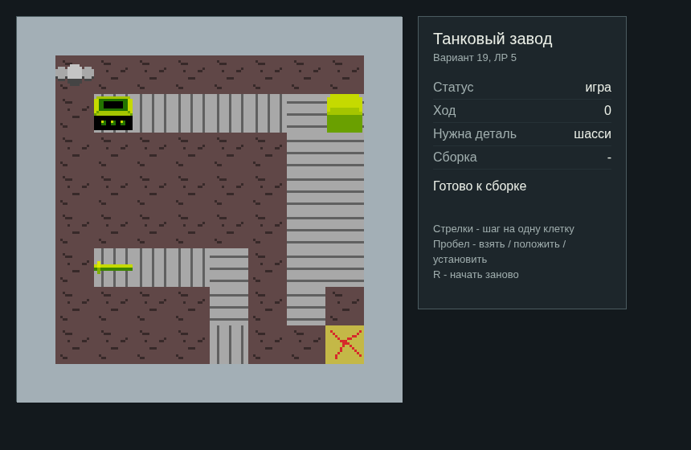
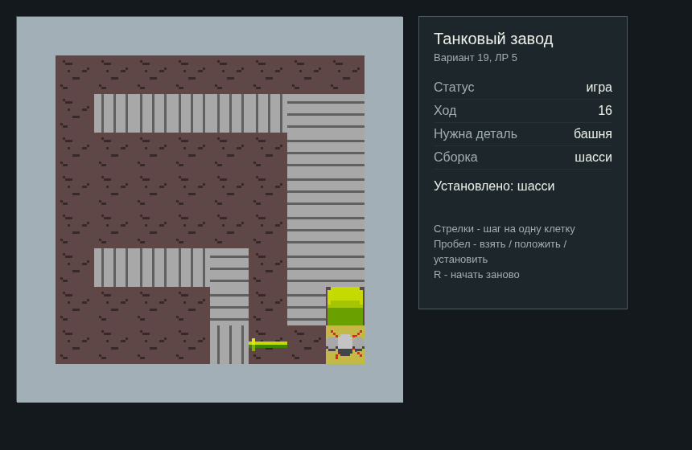

# ЛР5. Веб-виджет «Танковый завод»

Сетка 10x10 на CSS Grid. Логика берётся из `tank_factory_js`, без копирования правил.

## Запуск

ES-модули не работают через `file://`. Сервер поднимается из корня проекта:

```powershell
python -m http.server 8000
```

Открыть `http://localhost:8000/tank_factory_widget/`

## Управление

| Клавиши | Действие |
|---------|----------|
| Стрелки | шаг дрона на одну клетку |
| Пробел | взять деталь / положить / установить на платформу |
| R | новая партия |

После хода дрон и детали сдвигаются плавно: у элементов стоит `transition` по `transform`.

`js/board.js` строит клетки и фишки и двигает их. `js/Widget.js` - класс `Widget`: держит `FactoryGrid` и доску, методы `reset`, `move`, `interact`, `attachKeyboard` (зажатая клавиша `e.repeat` не считается). `js/widget.js` создаёт `Widget` и пишет панель. Класс `Widget` целиком подключается на сайте ЛР7.

## Классы и спрайты

Фон задаётся в `css/style.css` картинками из `assets/`:

| Класс | Картинка |
|-------|----------|
| `.drone` | `drone.png` |
| `.chassis` | `chassis.png` |
| `.turret` | `turret.png` |
| `.cannon` | `cannon.png` |
| `.wall` | `wall.png` |
| `.floor` | `floor.png` |
| `.assembly` | `assembly.png` |
| `.conveyor-left`, `.conveyor-right` | `conveyor_horizontal.png` |
| `.conveyor-up`, `.conveyor-down` | `conveyor_vertical.png` |

## Структура

```text
tank_factory_widget/
├── index.html
├── css/style.css
├── js/board.js
├── js/Widget.js
├── js/widget.js
├── screenshots/widget.png
├── screenshots/widget_mid.png
└── README.md
```




